<div align="center">

# WebCloner Showcase: TaskGo

**A full-site clone of [taskgo-oly.webflow.io](https://taskgo-oly.webflow.io/), produced with [WebCloner](https://github.com/x4zu/WebCloner) by [Reivan Elsyafir Pratama](https://www.x2zu.net/)**

Next.js 16 · React 19 · TypeScript · GSAP · measured against the live site

The clone carries the **WebCloner** name and logo instead of TaskGo, so every screenshot shows which side is which.

</div>

---

This repository is the proof: the complete output of `/webclone-full https://taskgo-oly.webflow.io/`, plus the evidence used to verify it. Every route of the Webflow site is rebuilt as editable React components, and the site's interactions run again from their own exported data.

## Measured fidelity

Full-page pixel fidelity of the clone against the live site, same viewport, from `fidelity-gate.mjs` (gate: ≥ 90% and page height within 3%).

| Route | 1440px | 768px | 390px | Page height |
|---|---|---|---|---|
| `/` | 93.20%* | 98.89% | 98.31% | +0.7%* |
| `/style-guide` | 99.61% | 99.31% | 98.86% | identical |
| `/license` | 99.22% | 98.78% | 97.58% | identical |
| `/changelog` | 99.38% | 99.01% | 98.21% | identical |
| `/401` | 99.32% | 99.01% | 98.27% | identical |
| `/404` | 99.42% | 99.16% | 98.39% | identical |

<sub>Full-page pixel fidelity from `fidelity-gate.mjs` (gate: ≥ 90%, height drift ≤ 3%). 6/6 routes pass. *The clone deliberately shows the WebCloner brand instead of TaskGo: the longer heading "Why Teams Choose WebCloner" wraps to two lines and shifts the rest of the home page by 65px, which lowers the full-page desktop score. Section-aligned comparisons below are unaffected.</sub>

<table>
  <tr>
    <th width="50%">TaskGo original</th>
    <th width="50%">WebCloner clone</th>
  </tr>
  <tr>
    <td>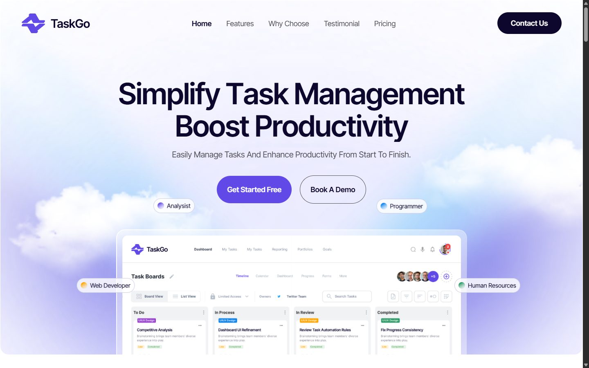</td>
    <td>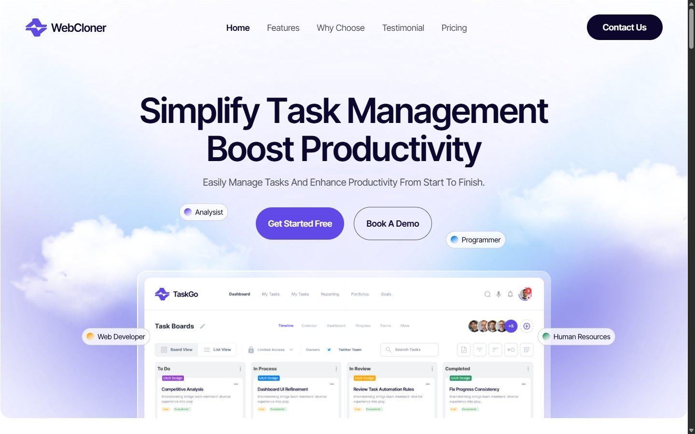</td>
  </tr>
  <tr><td colspan="2" align="center"><sub>Hero · 1440px · <b>99.22%</b></sub></td></tr>
  <tr>
    <td>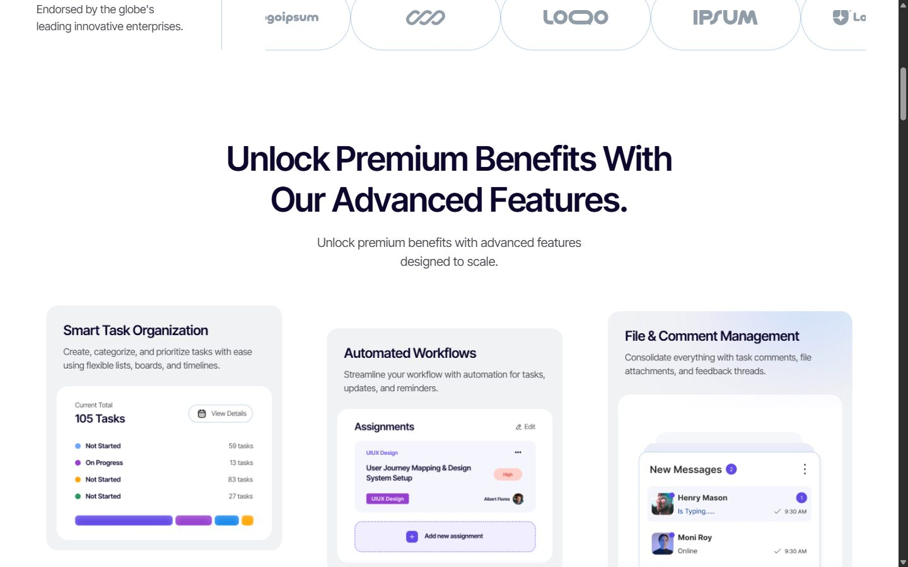</td>
    <td>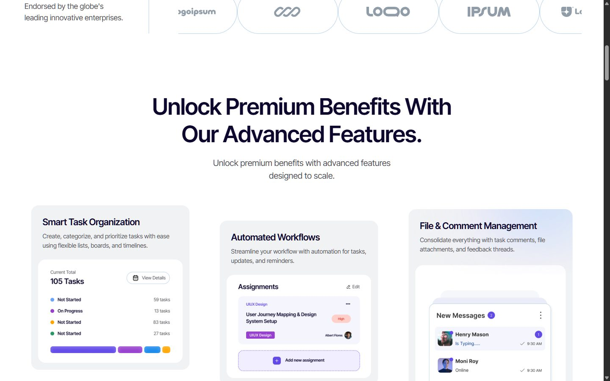</td>
  </tr>
  <tr><td colspan="2" align="center"><sub>Logo marquee + features · <b>98.01%</b></sub></td></tr>
  <tr>
    <td>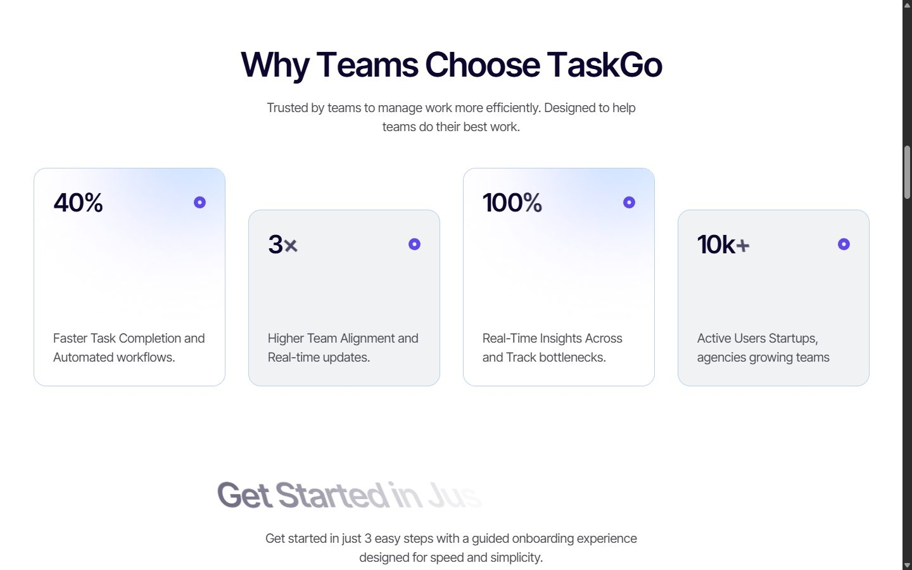</td>
    <td>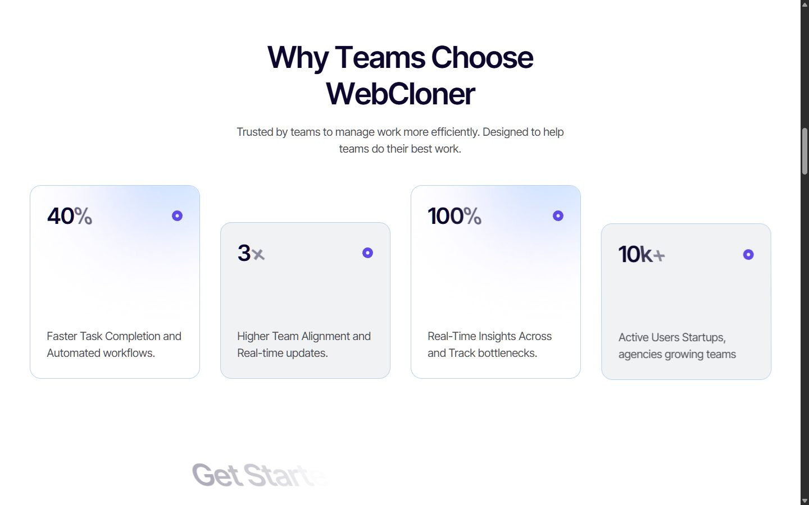</td>
  </tr>
  <tr><td colspan="2" align="center"><sub>Brand swapped to WebCloner in the clone (heading + logo), so the two are easy to tell apart</sub></td></tr>
  <tr>
    <td></td>
    <td>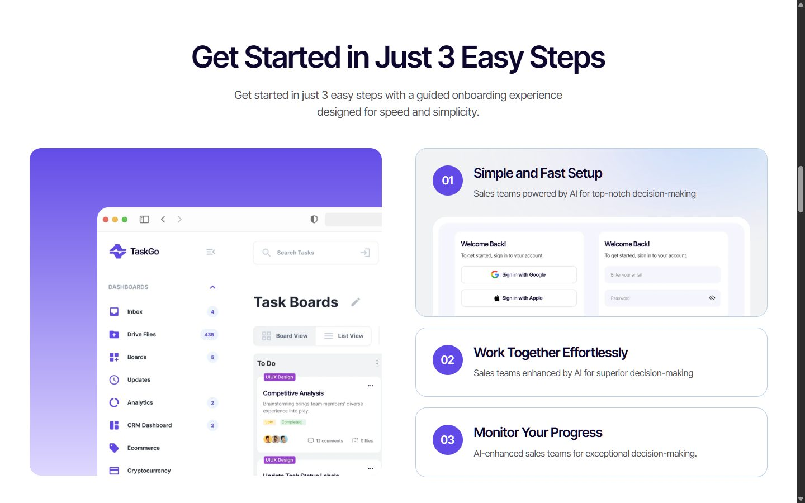</td>
  </tr>
  <tr><td colspan="2" align="center"><sub>Stats + scroll-scrubbed split-letter heading, caught mid-animation on both · <b>98.60%</b></sub></td></tr>
  <tr>
    <td>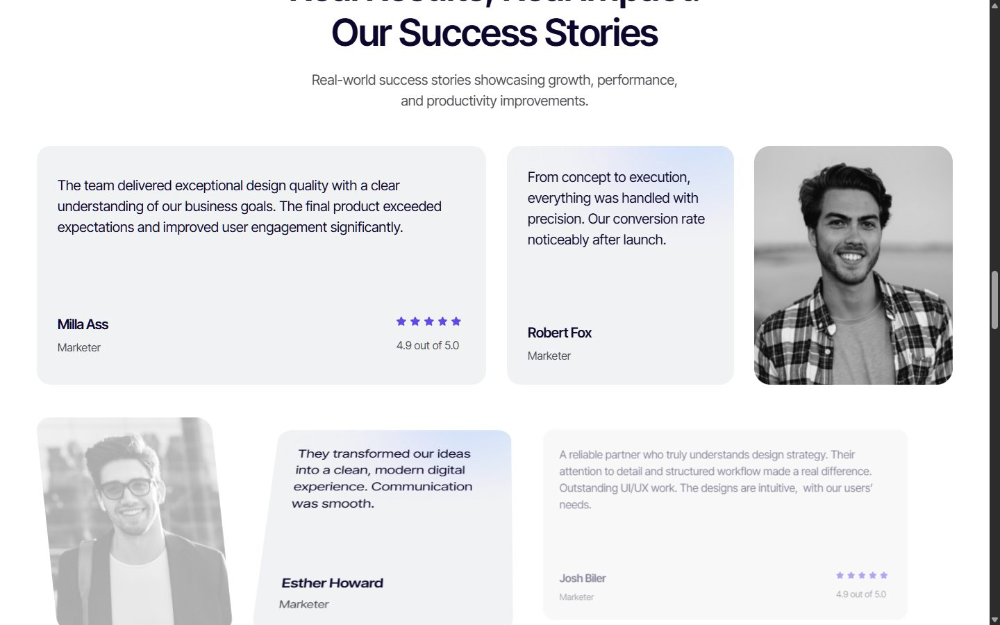</td>
    <td>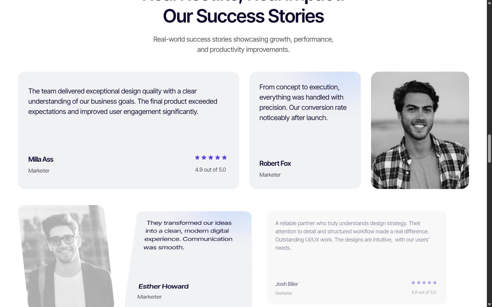</td>
  </tr>
  <tr><td colspan="2" align="center"><sub>Testimonials with scroll-scrubbed cards · <b>98.94%</b></sub></td></tr>
  <tr>
    <td>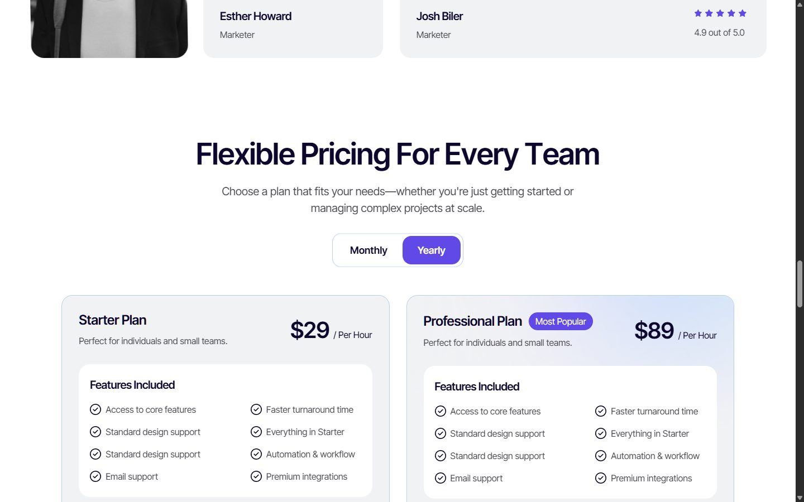</td>
    <td>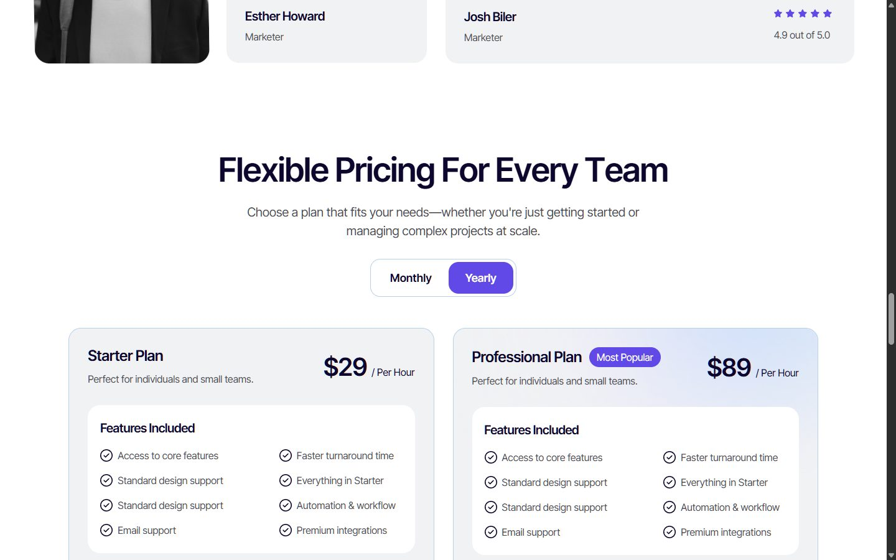</td>
  </tr>
  <tr><td colspan="2" align="center"><sub>Interaction: pricing toggle after a real click on "Yearly" · <b>95.46%</b></sub></td></tr>
  <tr>
    <td>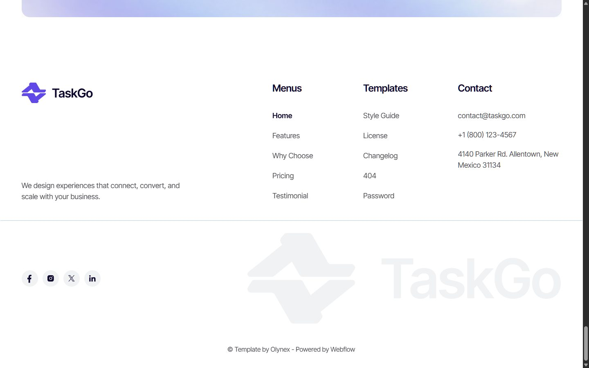</td>
    <td>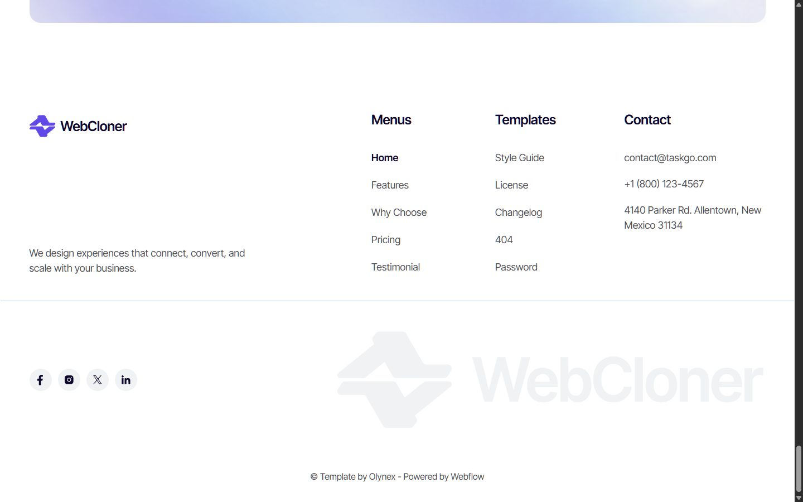</td>
  </tr>
  <tr><td colspan="2" align="center"><sub>Footer · TaskGo wordmark vs WebCloner wordmark · <b>99.20%</b></sub></td></tr>
  <tr>
    <td align="center">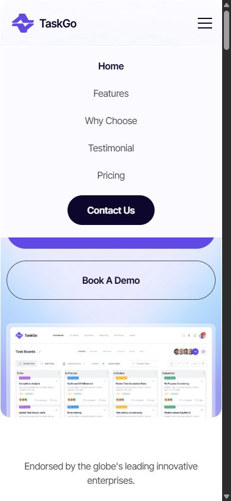</td>
    <td align="center">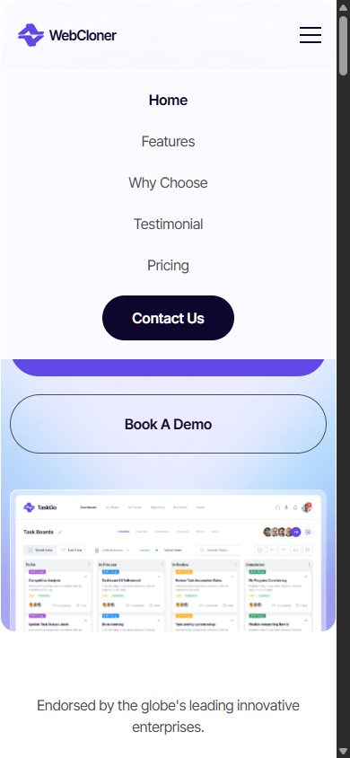</td>
  </tr>
  <tr><td colspan="2" align="center"><sub>Interaction: mobile menu opened with a real tap · 390px · <b>98.96%</b></sub></td></tr>
</table>

Also verified:

- Section-aligned home comparisons (hero, features, steps, testimonials, footer): 98.01-99.22%.
- Interactions driven with real clicks/taps: mobile menu 98.96%, FAQ accordion 99.45%, pricing Monthly/Yearly toggle 95.46% (same content, 4px scroll offset).
- `npm run check` (lint + typecheck + build): pass, 0 warnings.
- `audit-clone --strict`: no font, image, or color defects; no tracking scripts.
- Browser console on every route: 0 errors.

Evidence: [`docs/research/taskgo-oly-webflow-io/fidelity/FIDELITY.md`](docs/research/taskgo-oly-webflow-io/fidelity/FIDELITY.md) (with source, clone, and diff screenshots per route and width), [`NOTES.md`](docs/research/taskgo-oly-webflow-io/NOTES.md), [`CLONE_AUDIT.md`](CLONE_AUDIT.md).

## Run it

```bash
npm install
npm run dev          # http://localhost:3000
```

Production: `npm run build && node .next/standalone/server.js`.

## How it was built

| Layer | Implementation |
|---|---|
| Markup | Webflow HTML converted to React components, one file per section ([`scripts/webflow-to-jsx.mjs`](scripts/webflow-to-jsx.mjs) → [`src/components/sites/taskgo-oly-webflow-io/`](src/components/sites/taskgo-oly-webflow-io/)) |
| Styles | The site's stylesheet with every asset URL rewritten to local files; Tailwind without preflight |
| Fonts & images | Self-hosted Inter Tight and all images, harvested from what the browser actually loaded (`public/sites/taskgo-oly-webflow-io/`) |
| IX2 interactions | A small interpreter ([`SiteRuntime.tsx`](src/components/sites/taskgo-oly-webflow-io/SiteRuntime.tsx)) replaying the 216 exported events: scroll reveals, scroll-progress animations, logo marquee, FAQ accordion, hover effects, tab states |
| IX3 / GSAP | Split-letter headings, scroll-scrubbed step cards and review rows, rebuilt with GSAP + ScrollTrigger + SplitText from the registered values |
| Components | Mobile nav overlay, tabs, forms (local success state) |
| Branding | Visible TaskGo name and logos replaced by WebCloner ([`scripts/brand-webcloner.mjs`](scripts/brand-webcloner.mjs)): navbar, footer, integrations logo, footer wordmark, page title, "Why Teams Choose" heading. Logo canvases keep their original size; the icon mark is the template's. The dashboard mockup images in the hero still show "TaskGo" because the name is baked into those raster images. |

Routes: `src/app/page.tsx`, `style-guide/`, `license/`, `changelog/`, `401/`, and `not-found.tsx` for `/404`.

## Known gaps

- The hero load animation's duration/ease are not in the export; GSAP defaults (0.5s, power1.out) are used.
- Forms show the success state locally; nothing is sent.
- `/404` returns status 404 here (the source returns 200 with the same page).

## Ownership

This is a technical demonstration of WebCloner. The TaskGo template, its design, copy, and layout belong to **Olynex**; images are from **Freepik** and icons from **Flaticon** under their respective licenses; Inter Tight is under the SIL Open Font License. No rights to the template are granted by this repository. Do not use this code as a substitute for purchasing the template, and replace all branding, copy, and media before any real use. Owners who want this repository removed can open an issue.

The conversion scripts and runtime code written for this clone are by [Reivan Elsyafir Pratama](https://www.x2zu.net/).
